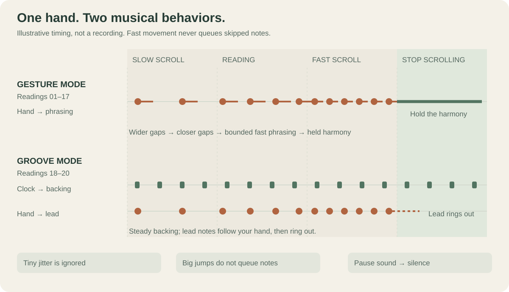
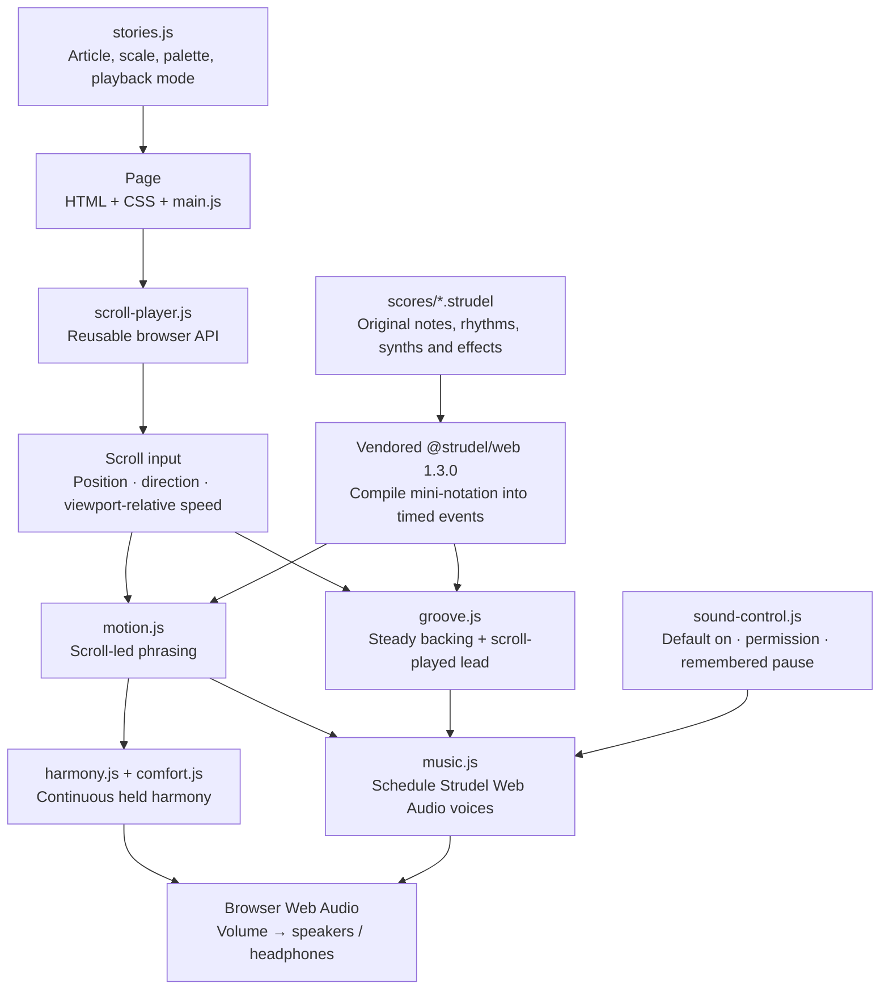
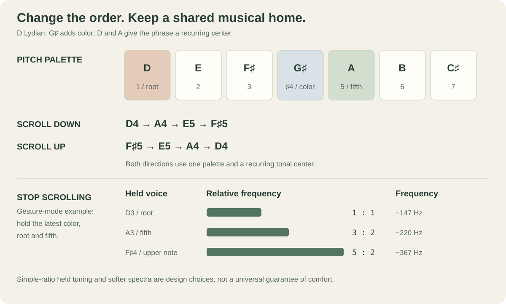
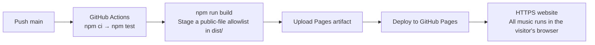

# Undertone

**Read a story. Play its score with your hand.**

[Listen on GitHub Pages](https://lsbonafe.github.io/undertone/) · [Try the standalone player](https://lsbonafe.github.io/undertone/examples/hello/) · [Browse the 20 readings](docs/readings.md) · [Open a Strudel score](scores/space.strudel)

Undertone turns scrolling into musical phrasing. Twenty readings pair a subject with an original score: ten source-linked adaptations and ten clearly labeled fictional stories. The score supplies a musical vocabulary; the reader supplies motion, direction and pauses.



Sound is **requested on by default**, but the control shows actual playback state. Where autoplay is permitted, music starts automatically. Otherwise, **Enable sound** remains visible until a click, tap or keypress unlocks audio; the first Enable click resumes the pending start instead of toggling it off. **Pause sound** appears when playback starts or is initializing, and the pressed indicator is only on while audio is running. A pause choice is remembered in that browser. Scrolling alone may not unlock browser audio; this follows the browser's [autoplay policy](https://developer.mozilla.org/en-US/docs/Web/Media/Guides/Autoplay).

## Use the player in another project

The browser module [`scroll-player.js`](scroll-player.js) plays a trusted `.strudel` file against an existing article element. The host page supplies its own text and controls; no server API or account is needed. [The small independent example](examples/hello/index.html) uses only its own HTML, a score, and this module.

For a bundled JavaScript project, install the repository from GitHub. Pin the resolved commit SHA for reproducible builds:

```sh
npm install "github:lsbonafe/undertone#main"
```

```js
import { createScrollScore } from 'undertone-scroll-scores/player';

const player = await createScrollScore({
  contentElement: document.querySelector('article'),
  scoreUrl: '/music/story.strudel',
  onStateChange: (state, control) => {
    button.textContent = control.label;
    button.setAttribute('aria-pressed', String(control.pressed));
  },
});
button.addEventListener('click', () => player.toggle());
// When removing the article: player.destroy();
```

`contentElement` must be attached to the document; this version listens to **page scrolling**, using that element's position and height as the musical range. One player can run per page. The default `mode: 'hold'` lets the current harmony continue when movement stops. For a steady backing groove, pass `mode: 'groove'`, a positive `bpm`, and optionally `character: 'vaporwave'` (the other supported character is `'electronic'`). Groove scores place the scroll-played lead on **orbit 1**. Both modes use the current 12-cycle score shape; groove divides it into three four-bar passages. Built-in custom sound names include `haze`, `grit`, `porcelain`, `u_tape`, `u_kick`, `u_hat`, and `u_snare`.

The returned player exposes `state`, `control`, `desired`, `enable()`, `toggle()`, `pause()`, `setVolume(0..1)`, `setScore(url, options?)`, and `destroy()`. `enable()` is idempotent; `toggle()` powers the visible button. `onStateChange(state, control)` reports `waiting`, `starting`, `playing`, `paused`, or `error`; `control` supplies the correct button label and pressed state. Optional callbacks are `onProgress(progress)`, `onNotes(notes, direction, mode, foreground)`, `onIdle(phase, heldNotes)`, and `onError(error)`. `autoStart: false` disables the default startup attempt; `preferenceKey` names the localStorage choice for each integration. Call `destroy()` when removing the article to mute audio and remove listeners.

Only load scores trusted by the site owner. The current Strudel compiler evaluates score code; it does not sandbox visitor submissions. The code and original scores are [AGPL-3.0-or-later](LICENSE), including when reused from GitHub.

## The stack, from article to speaker



| Layer | Technology | What it does |
| --- | --- | --- |
| Reading interface | HTML, CSS, native JavaScript modules | Renders stories, navigation, progress, pitch display and sound controls. |
| Musical language | Local `.strudel` files and **@strudel/web 1.3.0** | Describes notes, chords, rests, synths, samples, envelopes and effects. The bundled engine compiles and plays them. |
| Interaction | `motion.js`, `groove.js`, `music.js` | Converts scroll input into musical choices and schedules audio independently of browser animation frames. |
| Sustained sound | `harmony.js`, `comfort.js` | Keeps the harmonic moment sounding during a reading pause in gesture mode. |
| Sound sources | Strudel synths, ZZFX, custom Web Audio voices, original samples | Pure waves, subtractive/additive/FM colors, degradation, unison pads, saturated bass and sampling. |
| Development | Node.js 22+, `node:test`, `node-web-audio-api` | Runs a local server, stages static files and verifies timing and rendered audio. The native audio package is development-only. |
| Hosting | GitHub Actions → GitHub Pages | Tests and builds `dist/`, then publishes the static site. No application server runs in production. |

No visitor account, API key, DJ Opus service, remote music API or sample bank is required. The Strudel engine and audio material are bundled locally. Optional Google Fonts have system-font fallbacks.

## How a scroll becomes music

The page first measures **where you are**, **which way you move**, and **how quickly you cross the viewport**:

```text
progress = scrollY / (documentHeight - viewportHeight)
position in score = clamp(progress, 0, 1) × 12 cycles
speed ≈ |change in progress| × article travel in viewports / elapsed seconds
```

Each score spans **12 Strudel cycles**, divided into three four-cycle passages. A cycle is a unit of musical pattern time; it becomes a four-beat bar in groove mode. Speed is smoothed and tiny jitter is ignored. A short movement after a pause uses a nominal initial time interval, rather than dividing by the whole pause.

The subject is mapped to a scale, sound source and arrangement when a score is composed. The runtime does **not** infer notes from article sentiment or turn individual words into frequencies.

### Two meanings of “hold”

| Reader action | Gesture mode: readings 01–17 | Groove mode: readings 18–20 |
| --- | --- | --- |
| Scroll down | Advances through the score's note groups. | Plays the next foreground notes over a continuous backing loop. |
| Scroll up | Retraces note groups with normal attacks and releases. | Retraces the foreground line; the backing rhythm keeps moving forward. |
| Scroll slowly | Gives notes more space and longer releases. | Plays sparse foreground notes over the same backing tempo. |
| Scroll quickly | Speeds the musical pulse, bounds large jumps and thins dense chords. | Makes the lead denser and opens filters; the backing BPM stays fixed. |
| Stop scrolling | Stops melodic advancement and sustains the current harmonic moment. | Lets the lead ring out while the current four-bar backing passage repeats. |
| Pause sound / hide the page | Silences output and stops active playback scheduling. | Silences output and stops the repeating scheduler. |

**Gesture mode.** The inter-attack interval follows the implementation's bounded curve:

```text
interval_ms = clamp(520 / (1 + 1.35 × speed), 96, 500)
```

This prevents a fast flick from becoming hundreds of browser-event-triggered notes. Reversal discards the previous direction's pending groups. Large jumps keep a recent contour instead of replaying everything skipped. Faster playing reduces per-note gain and effect tails; octave-equivalent pitches reduce large melodic leaps.

**Groove mode.** The mall runs at **72 BPM**, the videotape at **68 BPM**, and the courier at **116 BPM**. A separate audio clock maintains that tempo. The reader plays a foreground voice authored on **orbit 1**, which the automatic backing excludes. Small scroll movements can therefore produce an explicit new sound without waiting for a long pad to attack again. Higher speed selects denser spacing, with a minimum gap of about **0.2 seconds**. Bar-boundary changes select the latest requested background passage, with no queue of skipped passages.

The lead is mixed above a quieter backing synth layer and starts at at least 80% of its authored gain even for a small movement. Forward/backward gestures also place it slightly differently in stereo. These arrangements make the interaction more explicit; they do not guarantee perceptual clarity on every device or for every listener.

## The musical theory



### A tonal home that works in both directions

Each story stays inside an authored **pitch collection** with a recurring center. For example, the space score uses **D Lydian**: D, E, F♯, G♯, A, B, C♯. G♯ is its raised fourth; D and A form a stable root/fifth reference beneath the changing melody.

Reading back changes the order of events, while the collection and recurring center remain shared. The motifs avoid relying entirely on a one-way dominant-to-tonic ending. This is a compositional strategy for these scores, not a claim that reversing any music preserves its effect. [Open Music Theory: diatonic modes](https://viva.pressbooks.pub/openmusictheory/chapter/intro-to-diatonic-modes-and-the-chromatic-scale/) explains the underlying collections.

### Voice leading, color and comfortable pauses

In gesture mode, a held voicing combines a root, its fifth and the latest upper melodic color. The upper note can move by an octave to stay in a manageable register. During a pause, the root/fifth settle into a **3:2 frequency relationship**; the upper voice uses a nearby simple interval ratio. Semitone, tritone and major-seventh colors are retained but weighted less strongly in that held blend.

The held sound also lowers level and brightness, reduces upper partials or FM depth where applicable, and crossfades rather than cutting abruptly. Additive and FM scores retain their synthesis character. A short sampled strike is reconstructed as a sustained harmonic blend; it is not looped mechanically forever. Gesture-mode holds do not invent an advancing melody.

Groove mode uses a different answer: **repeat a musical passage**. It preserves the actual extended chord voicings and the continuing bass/drum arrangement, without replacing them with a three-note drone or applying the held-tone retuning.

### Timbre is part of the composition

| Subject / score | Musical material | Sound-making idea |
| --- | --- | --- |
| Space / `space` | D Lydian over D–A | Rounded pure-wave voices leave room for the raised fourth. |
| Erosion / `erosion` | G Dorian | Subtractive synthesis removes upper harmonics as the article describes material being removed. |
| Fireflies / `fireflies` | A major pentatonic | Additive partials accumulate into a shared waveform, an analogy for collective activity. |
| A bell / `bell` | E minor pentatonic | Non-integer-ratio FM adds metallic partials without pretending to reproduce the physical bell. |
| A repaired cup / `porcelain` | C major pentatonic | An original sample is chopped, reversed and reassembled; fixed-seed choices make revisiting repeatable. |
| Empty mall / `mall` | Dmaj9 and Gmaj9 within D major | Detuned pads, slow pitch drift and filtered space form the loop; scrolling plays clearer FM chimes. |
| Old videotape / `vhs` | Major-nine shapes on C and F | Original sampled keys at half speed form the backing; scrolling plays a plucked unison answer. |
| Night courier / `courier` | D Dorian | Saturated, resonant bass and syncopated drums continue while scrolling plays a metallic FM line. |

Extended sevenths/ninths, modal semitone tension, sparse entrances, omissions, envelope changes and stereo placement all help tell a story. These are **compositional analogies**, not universal mappings from emotion to a scale.

The hold design is informed by research on [critical bandwidth and consonance](https://www.mpi.nl/world/materials/publications/levelt/Plomp_Levelt_Tonal_1965.pdf), [cultural variation in dissonance preference](https://mcdermottlab.mit.edu/papers/McDermott_etal_2016_consonance.pdf), and [sound category and perceived loudness](https://pmc.ncbi.nlm.nih.gov/articles/PMC12463550/). None of those studies validates this interface or guarantees that any preset stays pleasant indefinitely.

## Start locally

```sh
git clone https://github.com/lsbonafe/undertone.git
cd undertone
npm start
```

Open **http://127.0.0.1:4173**. Node.js **22 or newer** is required. Preview and static staging use built-in Node APIs, so neither needs an npm installation.

For the complete development checks:

```sh
npm ci
npm test
npm run build
```

`npm test` runs serially to avoid concurrent native audio renders competing for resources. The suite covers score compilation, palette membership, bidirectional traversal, both hold strategies, density limits, late initialization after pause, remembered sound choices, autoplay waiting/retry, mute, visibility changes and story navigation. Native Web Audio tests render the actual scores, including an isolated 24px scroll response checked within 150ms, headroom, foreground/background levels and long holds.

**Rendered audio checks are not a listening judgment.** Browser/device autoplay behavior and subjective mix quality still need real listening. The code does not claim a scientific comfort score.

Original sample material and the README diagrams can be regenerated without extra Python packages:

```sh
python3 scripts/make-porcelain.py
python3 scripts/make-genre-samples.py
python3 scripts/make-doc-diagrams.py
```

## Publish with GitHub Pages



[`.github/workflows/pages.yml`](.github/workflows/pages.yml) validates every pull request and deploys successful pushes to `main`. Repository Pages settings use **GitHub Actions** as the publishing source. The deployment needs `pages: write` and `id-token: write`; the build only needs read access to source.

`build.mjs` copies only the public application, scores, assets, docs, original-material generators and license files into `dist/`. It excludes tests, dependencies, server files, `.local/` logs and Git metadata. Relative asset URLs and query-string story selection support GitHub's `/undertone/` repository subpath. Only this static artifact is hosted; no account credentials or service processes are deployed.

## License and provenance

Code and original compositions are **AGPL-3.0-or-later**. The unmodified, locally vendored Strudel browser bundle is pinned to **@strudel/web 1.3.0**; package metadata and its distribution hash are included under `assets/vendor/`. See [LICENSE](LICENSE) and [THIRD_PARTY.md](THIRD_PARTY.md).

All five bundled recordings and the two custom registered instruments are original to this project. The custom `haze` and `grit` voices use Strudel's [custom-sound interface](https://strudel.cc/technical-manual/sounds/); score effects and playback still run through Strudel. AudioWorklet-only effects are disabled in this demo.

Source articles keep their own copyrights. The NASA image retains its stated credits. The other illustrations and both README diagrams are original. The [reading catalogue](docs/readings.md) preserves article attribution, dates and the explicit fiction labels.
