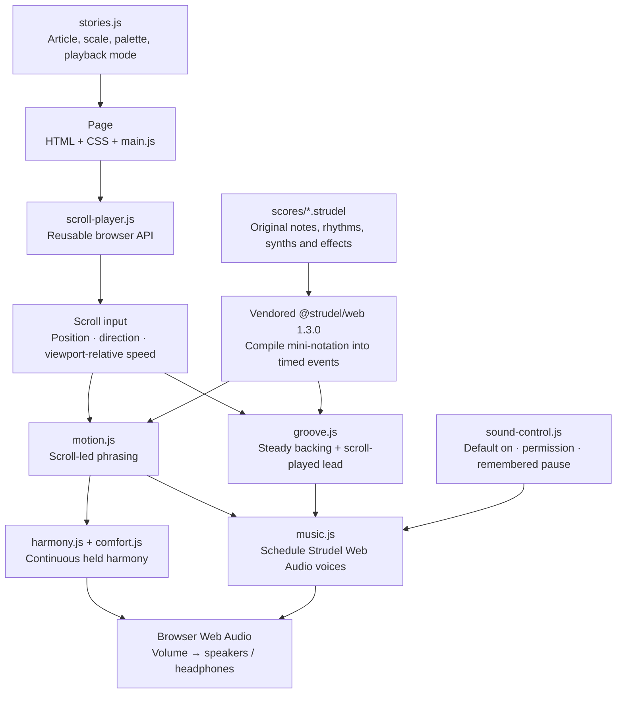
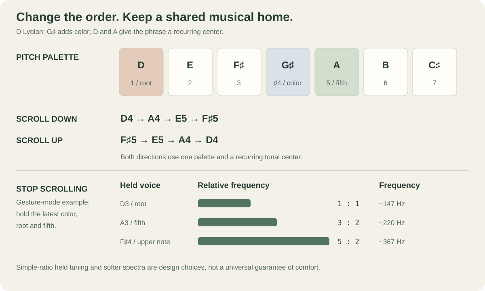

# Playback architecture and musical theory

The reusable API supports `touch: "notes"` (the original event-based interpretation) and `touch: "continuous"` (sustained harmonic blending). The notes-mode details below describe the original performance path. See [the API](player.md) and [continuous synthesis](texture-study.md).

## The stack, from article to speaker



| Layer | Technology | What it does |
| --- | --- | --- |
| Reading interface | HTML, CSS, native JavaScript modules | Renders stories, navigation, progress, pitch display and sound controls. |
| Musical language | Local `.strudel` files and **@strudel/web 1.3.0** | Describes notes, chords, rests, synths, samples, envelopes and effects. The bundled engine compiles and plays them. |
| Interaction | `motion.js`, `groove.js`, `music.js` | Converts scroll input into musical choices and schedules audio independently of browser animation frames. |
| Sustained sound | `harmony.js`, `comfort.js` | Keeps the harmonic moment sounding during a reading pause in gesture mode. |
| Sound sources | Strudel synths, ZZFX, custom Web Audio voices, original samples | Pure waves, subtractive/additive/FM colors, degradation, unison pads, saturated bass and sampling. |
| Development | Node.js 22+, `node:test`, `node-web-audio-api` | Runs a local server, stages static files and verifies timing and rendered audio. The native audio package is development-only. |

No visitor account, API key, DJ Opus service, remote music API or sample bank is required. The Strudel engine and audio material are bundled locally. Optional Google Fonts have system-font fallbacks.

## How a scroll becomes music

The page first measures **where you are**, **which way you move**, and **how quickly you cross the viewport**:

```text
progress = scrollY / (documentHeight - viewportHeight)
position in score = clamp(progress, 0, 1) × 12 cycles
speed ≈ |change in progress| × article travel in viewports / elapsed seconds
```

Each score spans **12 Strudel cycles**, divided into three four-cycle passages. A cycle is a unit of musical pattern time; it becomes a four-beat bar in groove mode. Speed is smoothed and tiny jitter is ignored. A short movement after a pause uses a nominal initial time interval, rather than dividing by the whole pause.

The subject is mapped to a scale, sound source and arrangement when a score is composed. The runtime does **not** infer notes from article sentiment or turn individual words into frequencies.

### Two meanings of “hold”

| Reader action | Gesture mode: readings 01–17 | Groove mode: readings 18–20 |
| --- | --- | --- |
| Scroll down | Advances through the score's note groups. | Plays the next foreground notes over a continuous backing loop. |
| Scroll up | Retraces note groups with normal attacks and releases. | Retraces the foreground line; the backing rhythm keeps moving forward. |
| Scroll slowly | Gives notes more space and longer releases. | Plays sparse foreground notes over the same backing tempo. |
| Scroll quickly | Speeds the musical pulse, bounds large jumps and thins dense chords. | Makes the lead denser and opens filters; the backing BPM stays fixed. |
| Stop scrolling | Stops melodic advancement and sustains the current harmonic moment. | Lets the lead ring out while the current four-bar backing passage repeats. |
| Pause sound / hide the page | Silences output and stops active playback scheduling. | Silences output and stops the repeating scheduler. |

**Gesture mode.** The inter-attack interval follows the implementation's bounded curve:

```text
interval_ms = clamp(520 / (1 + 1.35 × speed), 96, 500)
```

This prevents a fast flick from becoming hundreds of browser-event-triggered notes. Reversal discards the previous direction's pending groups. Large jumps keep a recent contour instead of replaying everything skipped. Faster playing reduces per-note gain and effect tails; octave-equivalent pitches reduce large melodic leaps.

**Groove mode.** The mall runs at **72 BPM**, the videotape at **68 BPM**, and the courier at **116 BPM**. A separate audio clock maintains that tempo. The reader plays a foreground voice authored on **orbit 1**, which the automatic backing excludes. Small scroll movements can therefore produce an explicit new sound without waiting for a long pad to attack again. Higher speed selects denser spacing, with a minimum gap of about **0.2 seconds**. Bar-boundary changes select the latest requested background passage, with no queue of skipped passages.

The lead is mixed above a quieter backing synth layer and starts at at least 80% of its authored gain even for a small movement. Forward/backward gestures also place it slightly differently in stereo. These arrangements make the interaction more explicit; they do not guarantee perceptual clarity on every device or for every listener.

## The musical theory



### A tonal home that works in both directions

Each story stays inside an authored **pitch collection** with a recurring center. For example, the space score uses **D Lydian**: D, E, F♯, G♯, A, B, C♯. G♯ is its raised fourth; D and A form a stable root/fifth reference beneath the changing melody.

Reading back changes the order of events, while the collection and recurring center remain shared. The motifs avoid relying entirely on a one-way dominant-to-tonic ending. This is a compositional strategy for these scores, not a claim that reversing any music preserves its effect. [Open Music Theory: diatonic modes](https://viva.pressbooks.pub/openmusictheory/chapter/intro-to-diatonic-modes-and-the-chromatic-scale/) explains the underlying collections.

### Voice leading, color and comfortable pauses

In gesture mode, a held voicing combines a root, its fifth and the latest upper melodic color. The upper note can move by an octave to stay in a manageable register. During a pause, the root/fifth settle into a **3:2 frequency relationship**; the upper voice uses a nearby simple interval ratio. Semitone, tritone and major-seventh colors are retained but weighted less strongly in that held blend.

The held sound also lowers level and brightness, reduces upper partials or FM depth where applicable, and crossfades rather than cutting abruptly. Additive and FM scores retain their synthesis character. A short sampled strike is reconstructed as a sustained harmonic blend; it is not looped mechanically forever. Gesture-mode holds do not invent an advancing melody.

Groove mode uses a different answer: **repeat a musical passage**. It preserves the actual extended chord voicings and the continuing bass/drum arrangement, without replacing them with a three-note drone or applying the held-tone retuning.

### Timbre is part of the composition

| Subject / score | Musical material | Sound-making idea |
| --- | --- | --- |
| Space / `space` | D Lydian over D–A | Rounded pure-wave voices leave room for the raised fourth. |
| Erosion / `erosion` | G Dorian | Subtractive synthesis removes upper harmonics as the article describes material being removed. |
| Fireflies / `fireflies` | A major pentatonic | Additive partials accumulate into a shared waveform, an analogy for collective activity. |
| A bell / `bell` | E minor pentatonic | Non-integer-ratio FM adds metallic partials without pretending to reproduce the physical bell. |
| A repaired cup / `porcelain` | C major pentatonic | An original sample is chopped, reversed and reassembled; fixed-seed choices make revisiting repeatable. |
| Empty mall / `mall` | Dmaj9 and Gmaj9 within D major | Detuned pads, slow pitch drift and filtered space form the loop; scrolling plays clearer FM chimes. |
| Old videotape / `vhs` | Major-nine shapes on C and F | Original sampled keys at half speed form the backing; scrolling plays a plucked unison answer. |
| Night courier / `courier` | D Dorian | Saturated, resonant bass and syncopated drums continue while scrolling plays a metallic FM line. |

Extended sevenths/ninths, modal semitone tension, sparse entrances, omissions, envelope changes and stereo placement all help tell a story. These are **compositional analogies**, not universal mappings from emotion to a scale.

The hold design is informed by research on [critical bandwidth and consonance](https://www.mpi.nl/world/materials/publications/levelt/Plomp_Levelt_Tonal_1965.pdf), [cultural variation in dissonance preference](https://mcdermottlab.mit.edu/papers/McDermott_etal_2016_consonance.pdf), and [sound category and perceived loudness](https://pmc.ncbi.nlm.nih.gov/articles/PMC12463550/). None of those studies validates this interface or guarantees that any preset stays pleasant indefinitely.
